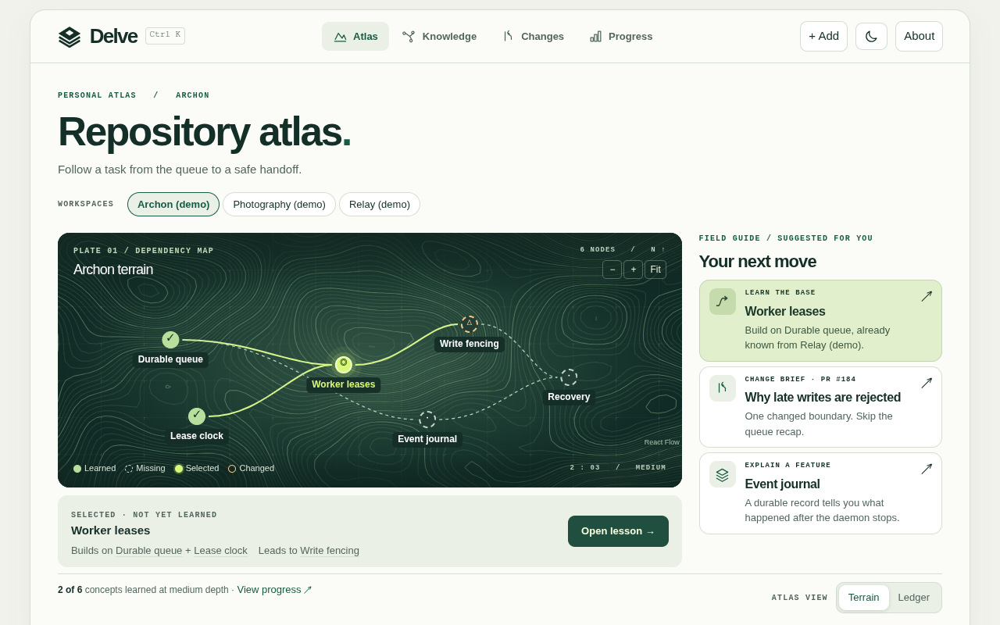
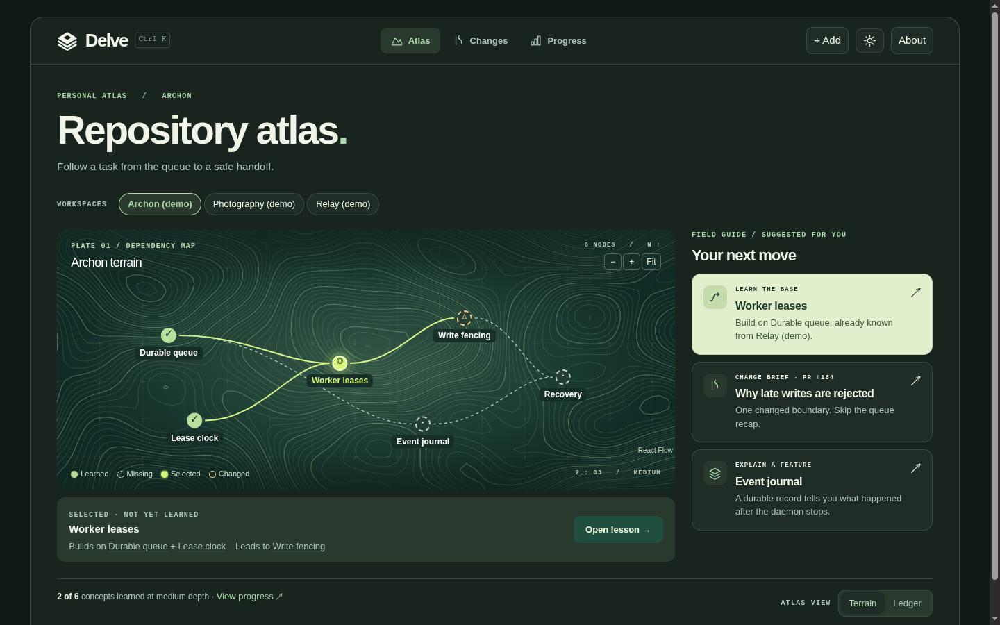

# Delve

Learn the codebase your agents are building. A local-first, open-source desktop app (Electron) that keeps developers in touch with a repository: learn it from scratch, then follow what changed and why, at three depths.


## Install

On Linux or macOS, install the latest release with:

```sh
curl -fsSL https://raw.githubusercontent.com/mengsig/delve/main/install.sh | sh
```

The installer verifies the release checksum. On Linux it installs an AppImage and desktop launcher
in your home directory, using AppImage extraction to work without FUSE 2. On macOS
it installs Delve in Applications. To install a specific release, download
[`install.sh`](https://github.com/mengsig/delve/blob/main/install.sh) and run
`DELVE_VERSION=v1.2.3 sh install.sh` with the desired release tag. Run `sh install.sh --uninstall`
to remove the installed files, or use `curl -fsSL https://raw.githubusercontent.com/mengsig/delve/main/install.sh | sh -s -- --uninstall`
without downloading the script first. The installer lists what it removed and where it left files.
If an older macOS installer saved only the app location, move its `Delve.app` to Trash or
reinstall the same release to record the bundle files before uninstalling.

Alternatively, download a package and `SHA256SUMS` from the
[releases page](https://github.com/mengsig/delve/releases) and verify its SHA-256 checksum before
installation. Packages are not yet code-signed.

- **Linux:** make the AppImage executable and run it, or install the `.deb` with `sudo apt install ./Delve-*.deb`. See [Linux setup](docs/linux.md) for FUSE alternatives and manual desktop integration.
- **macOS:** open the DMG and drag Delve to Applications. If Gatekeeper blocks an unsigned build, use System Settings → Privacy & Security → Open Anyway.
- **Windows:** download and run the setup executable. If SmartScreen reports an unknown publisher, choose More info → Run anyway after verifying the checksum.




Open the Atlas to explore prerequisites on a terrain map or switch to the Folio relationship list.
On first launch, type a topic or paste a repository into the focused field. Medium is the starting
depth. Use **Advanced options** to change it or choose a different tutor. **Explore demo atlas**
opens the offline Archon, Relay and Photography workspaces. Use **+ Add** for more workspaces.
From the Atlas, use the workspace buttons to switch directly or **Continue** to reopen your last
lesson, environment or change, including work from another workspace.

Open a concept at High, Medium or Low depth to read its lesson and ask the tutor a question.
For a new topic, the source form shows the tutor, model and request size. **Allow once and start
lesson** opens the reader as the tutor prepares the first block. **Always allow for this workspace**
also permits future tutor requests with that provider. Expand **Exact request** to see the prompt.
The tutor receives concept summaries, selected-depth evidence and recent conversation from the local
graph. No repository files are attached to topic requests. You can inspect individual questions,
cancel a turn, or keep exploring and reopen a completed response from its notification. The optional check updates local evidence, and the
tutor explains its next suggestion. Reset a check in **Progress** at its recorded workspace.

## Learn a repository

Paste a Git folder path, GitHub URL or `owner/name` into the repository field, or drop the folder
or URL there. With a signed-in CLI, the form prepares the file list and request automatically.
Delve reads the selected
commit from the object database. GitHub workspaces use a shallow bare clone of the default branch
in Delve’s user data directory. Install Git and use `gh auth login` for private repositories and
pull requests. Delve uses read-only operations with that login.

Select the files to include and review their names, sizes, revision and exact provider request.
**Add and build map** attaches the repository and starts generation with one confirmation.
The progress panel stays visible as you explore another workspace. The Atlas fills in when the map is ready. If you have left the Atlas, **Open map** takes you back.
Portable concepts such as TCP have one entry in Knowledge. Verified understanding carries across
repositories at the demonstrated depth and shallower. The learning path then recommends how the
current repository uses the concept, or offers a top-up when you choose a deeper lesson. **Used in**
lists the repositories that link to the shared concept. Choose **Map more files** to expand a map.
Each slice contains at most 128 text files, 128 KiB per file and 1 MiB total.

In **Changes**, select a commit or pull request from the branch timeline. Search by title or
reference, narrow the list by branch, author or change type, or switch to **Folio** for its list
equivalent. Use the arrow keys to move, Enter to open and Esc to return to history.

**Files changed** shows the first-parent diff for a commit or the GitHub diff for a pull request.
Partial coverage identifies unavailable patches. The change page prepares a source preview and shows the files, size and tutor.
**Teach me this change** approves the displayed diff and opens the new lesson, or reopens the saved
lesson immediately. You can remember or revoke source approvals separately for maps and changes. **Explanation** includes the recommendation and its
reason. Follow a linked line or a **Concepts** entry to the Atlas. A concept introduced by an
unmerged PR can be viewed there temporarily while the reviewed map stays separate.
Saved briefs remain available offline. **Refresh history** checks the source again.

Installed packages accept learn links such as
`delve://learn?workspace=octo/site&pr=184`. Use an existing repository workspace UUID or a GitHub
`owner/name` and exactly one of `pr`, `commit` (a hexadecimal Git ID), or `proposed` (a reference
to discuss). Delve displays the incoming workspace and reference for approval. Opening a repository
or preparing a request requires a separate decision from sending material to the provider.

The demo tutor runs entirely offline. The Archon demo includes an illustrative brief for PR #184.

- [Learning journeys and measured action counts](docs/ux-audit.md)
- Product direction: [`docs/product.md`](docs/product.md)
- Binding requirements (R1–R18): [`docs/requirements.md`](docs/requirements.md)
- Approved design: [`docs/design/proposal-v1.html`](docs/design/proposal-v1.html) (open in a browser)

## Global knowledge

Open **Knowledge** in the header or through Ctrl/⌘-K. The map starts in your workspace’s area when
it contains concepts. Choose **All workspaces** above the map to see bridges and transfers. The guide
selects an eligible lesson at your reading depth and explains which prerequisites you already know.
Start it directly from the guide. If your tutor needs to generate an opening, you can inspect the
exact request and grant it once with the same button.

Drag to pan, scroll to zoom, or choose **Fit map**. With the map focused, arrow keys preview
concepts, Enter selects, Shift + arrows pan, +/− zoom, and Home fits. **Find a concept** searches the
current area and filters by state or verified depth. **Learned list** shows dated evidence across
depths and can group it by workspace. Open **Connections & details** to focus the neighbourhood,
inspect prerequisites and transfers, review a concept, or visit its Atlas. **Back to Knowledge**
returns to your original workspace, map selection, filters and camera.

**Find connections** previews the exact request before a tutor proposes transfer links. Each
suggestion includes a reason and model provenance, and you can remove it. Your graph and view
settings are stored locally. The built-in demo has a separate map you can explore from an empty
personal record.

## Interactive lessons

Open **Worker leases** in Archon or **Moving subjects** in Photography. Advance the lease clock and decide
whether to accept the late write, or change shutter speed and ISO and capture the rider. The observation
appears in the conversation, with a reason for the next exercise. **Progress** shows the evidence and
its originating workspace. Each lab has a keyboard interface and a text alternative.

The tutor can insert instruments into an opening lesson or a later message. A network instrument lets
you wire simulated ports by dragging or by selecting an output followed by an input. For a custom
topic, the tutor can also supply a self-contained program with its own state, drawing and controls.
Custom programs run as practice. Host-verifiable rubrics currently ship for the dispatch, exposure
and network instruments. See the [environment protocol](docs/environments.md).

To generate lessons, Delve uses a CLI you already have and are signed in to:
[Claude Code](https://code.claude.com/docs/en/headless) (`claude`) or
[Codex](https://developers.openai.com/codex/noninteractive/) (`codex`). Delve never calls a paid API
itself and never copies your credentials. It only runs a CLI signed in with a subscription
(claude.ai or ChatGPT); a CLI signed in with an API key is shown and refused, because it bills per
use. If neither CLI is on your `PATH`, Delve shows "not found".
Tutor and repository requests use the top-level model in Codex's config, if present and valid, or the CLI's
default model. Claude uses its CLI default. Set `DELVE_CODEX_MODEL` or `DELVE_CLAUDE_MODEL`
before launching Delve to request a specific model; this takes precedence over Codex's config.
Delve reads only the Codex model as data and runs both CLIs with isolation flags, so they do not
load user or project settings, tools, or plugins.

Ctrl+K (⌘K on macOS) or the **Delve** button opens the command palette. Search views, workspaces
and recent lessons. Use the arrow keys and Enter to open a result, or Escape to return.
Alt+Left returns to the previous page.

## Develop

Requirements: Node.js 24 (22.13 or later works) and npm. The project uses **npm**; commit
`package-lock.json` changes.

```sh
npm ci            # install dependencies (downloads Electron)
npm run dev       # start the app with hot reload
```

| Script | What it does |
| --- | --- |
| `./scripts/ci.sh` | Run Linux lint, typecheck, unit and provider tests, build, and desktop smoke serially (uses Xvfb when available). Set `DELVE_PACKAGE_EXECUTABLE` to also smoke a prepared Linux package |
| `npm run lint` | ESLint over the whole project |
| `npm run typecheck` | TypeScript for main/preload and for the renderer |
| `npm test` | Vitest unit tests (database, IPC, security guards, provider runner with a fake CLI) |
| `npm run test:providers` | Only the provider runner tests; CI runs them on Linux, macOS and Windows |
| `npm run test:smoke` | Builds, then launches the app with Playwright and drives workspace, graph and evidence flows |
| `npm run build` | Builds main, preload and renderer into `out/` |
| `npm run package` | Builds installers for the current platform into `release/` |
| `npm run package:linux` / `:mac` / `:win` | Builds AppImage + deb, dmg, or NSIS |

The smoke test needs a display. On Linux CI it runs under Xvfb:
`xvfb-run --auto-servernum -- npm run test:smoke`.

Delve stores its database (`delve.sqlite`) in Electron's user data directory. Set
`DELVE_USER_DATA_DIR=/some/dir` to use another one, as the smoke test does.

## Layout

```
src/shared/      types and the typed IPC channel map shared by every process
src/main/        Electron main: window, security policy, app:// protocol, IPC handlers
src/main/db/     node:sqlite database, versioned migrations, knowledge-graph domain functions
src/main/providers/  claude/codex detection and the sandboxed CLI runner
src/preload/     the only bridge: a typed `window.delve.invoke`
src/renderer/    React UI (Vite)
tests/smoke/     Playwright smoke test of the built app
```

## Security model

The renderer is sandboxed and context-isolated, without Node integration, and loads only from the
`app://delve` origin with a strict Content Security Policy. Navigation, new windows, webviews and
permission requests are refused. Main validates every IPC request and ignores frames from other
origins. Packaged builds disable `ELECTRON_RUN_AS_NODE`, `NODE_OPTIONS` and inspector flags via
Electron fuses. Provider CLIs run with fixed arguments, no shell, no write tools or project plugins, in an empty
temporary directory, and without API-key environment variables. Delve runs a CLI only when it is
signed in with a subscription; an API key, including one the CLI has stored, is reported as "not
signed in with a subscription". On Linux and macOS each CLI runs in its own process group: timeout
or cancellation sends the group SIGTERM, then SIGKILL after a grace period. On Windows,
`taskkill /T /F` stops the tree on timeout or cancellation. Either way a signal is sent only while
the CLI has not exited, so it cannot reach a reused process id (on Windows the CLI may still exit
while taskkill starts). A run settles when the CLI exits, without waiting on pipes a descendant
still holds. Limits: descendants that outlive the CLI's exit are not stopped, and one that leaves
the process group or session is out of scope (claude and codex do neither). Output is capped at
8 MiB, including Codex's final-message file. npm `.cmd` launchers on Windows are run through Node directly, never
through a shell.

## Privacy

Workspaces, conversations, evidence, and the SQLite database stay on your device. The demo tutor is offline. When you approve a provider request, Delve sends the displayed prompt, selected repository material where applicable, and relevant learning context through the chosen CLI to its provider. The provider's own terms and retention policies apply. GitHub repository and pull request operations contact GitHub using your existing Git or `gh` authentication. Delve does not copy CLI credentials or send telemetry.

See [CONTRIBUTING.md](CONTRIBUTING.md) to contribute and [SECURITY.md](SECURITY.md) to report a vulnerability.

## License

[MIT](LICENSE)
